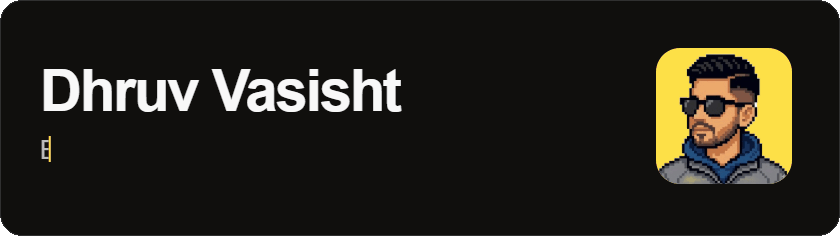

<picture>
  <source media="(prefers-reduced-motion: reduce) and (max-width: 600px)" srcset="./assets/hero-mobile.png" />
  <source media="(prefers-reduced-motion: reduce)" srcset="./assets/hero.png" />
  <source media="(max-width: 600px)" srcset="./assets/hero-mobile.gif" />
  
</picture>

I'm a **full stack engineer** building for **web and mobile**, focused on **system design, performance and reliable architecture**.

  <a href="https://www.dhruvvasisht.com">Portfolio</a> &nbsp;·&nbsp;
  <a href="https://www.dhruvvasisht.com/blog">Writing</a> &nbsp;·&nbsp;
  <a href="https://www.linkedin.com/in/dhruv-vasisht07/">LinkedIn</a> &nbsp;·&nbsp;
  <a href="https://x.com/noobKoderr">X</a> &nbsp;·&nbsp;
  <a href="mailto:vasisht.dhruv7@gmail.com">Email</a>

  
  
  
  
  
  
  
  

Prisma &nbsp;·&nbsp; Redis / BullMQ &nbsp;·&nbsp; Docker &nbsp;·&nbsp; Sentry

**Building [BuildEnfra](https://buildenfra.in/)**

- Built ERP modules for procurement, work orders, inventory and project management across **8+ departments** and **10+ infrastructure projects**.
- Redesigned the **React Native + Expo** app for Android and iOS, published on the App Store.
- Independently built the **HR platform** for employee records, attendance, leave and payroll.

[More about my work](https://www.dhruvvasisht.com/work-experience)

B.Tech Computer Science graduate from [SRM University, Sonepat](https://srmuniversity.ac.in/). Gamer off the clock.
