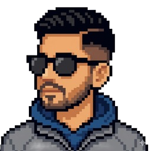

  

<h1 align="center">Dhruv Vasisht</h1>

<strong>Full stack engineer, web &amp; mobile.</strong>

  <a href="https://www.dhruvvasisht.com">Portfolio</a> &nbsp;·&nbsp;
  <a href="https://www.dhruvvasisht.com/blog">Writing</a> &nbsp;·&nbsp;
  <a href="https://www.linkedin.com/in/dhruv-vasisht07/">LinkedIn</a> &nbsp;·&nbsp;
  <a href="https://x.com/noobKoderr">X</a> &nbsp;·&nbsp;
  <a href="mailto:vasisht.dhruv7@gmail.com">Email</a>

I build web and mobile applications, contribute to open source, and turn real-world problems into useful products. My focus is **system design, performance, and reliable architecture**.

## Currently building

I'm a **Software Engineer at Tracks And Towers Infratech**, working on [BuildEnfra](https://buildenfra.in/), an AI-driven construction ERP supporting **8+ departments** and **10+ infrastructure projects**.

- **Web:** procurement, work orders, inventory, and project management with Next.js, TypeScript, and Node.js.
- **Mobile:** redesigned the React Native and Expo app for Android and iOS, published on the App Store.
- **Systems:** independently built the HR platform; implemented BullMQ with Upstash Redis for bulk approvals, PDF generation, and background processing.

[More about my work](https://www.dhruvvasisht.com/work-experience)

## Selected projects

**[DevFix](https://github.com/DhruvVasisht/DevFix)**  
A team collaboration platform with secure file sharing, audio/video calls, and Gemini-powered coding assistance.  
Next.js · TypeScript · PostgreSQL · Prisma · Socket.io

**[JobQuest](https://github.com/DhruvVasisht/JobQuest)**  
A platform connecting students and recruiters through role-based dashboards, resume uploads, and job application workflows.  
React · Node.js · Express · MongoDB

[Explore my projects](https://www.dhruvvasisht.com/projects)

## Tech stack

**Web & mobile**

  
  
  
  
  
  
  

**Backend & data**

  
  
  
  
  
  
  
  

**Delivery & monitoring**

  
  
  
  
  

**Coding tools:** VS Code · Cursor · Antigravity · Codex · Claude Code

  
More technologies I've worked with

C · Java · Python · HTML · CSS · Bootstrap · Redux · MySQL · Postman · Linux

## A little more

I'm a B.Tech Computer Science graduate from [SRM University, Sonepat](https://srmuniversity.ac.in/). Outside of building software, I enjoy gaming.

Have a project in mind? [Get in touch](mailto:vasisht.dhruv7@gmail.com).
